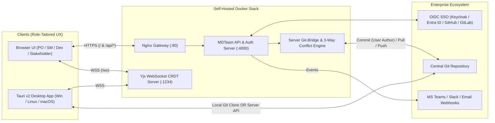

# MDTeam Workspace

[](https://github.com/BLS-ISP/MDTeam/actions/workflows/ci.yml)
[](https://github.com/BLS-ISP/MDTeam/actions/workflows/docker.yml)
[](https://github.com/BLS-ISP/MDTeam/actions/workflows/build.yml)

**MDTeam Workspace** is a collaborative, **Git-native alternative to Jira, Confluence, and classic Scrum suites**—purpose-built for software engineering teams, Scrum Masters, Product Owners, and non-technical Stakeholders.

Available both as a **native cross-platform desktop client (Tauri v2 / Rust)** and a **self-hosted multi-user web platform (Next.js 16 + Node 20 Git-Bridge API + Yjs CRDTs)**, MDTeam stores every Epic, User Story, Subtask, Sprint, Release, Wiki page, Architecture Decision Record (ADR), and arc42 document as human-readable Markdown + YAML files directly inside your Git repository—**zero vendor lock-in and zero external database required**.

> 📖 **Full Manual:** See the [**User & Administrator Guide (`docs/USER_AND_ADMIN_GUIDE.md`)**](docs/USER_AND_ADMIN_GUIDE.md) for step-by-step Scrum workflows, SSO/OIDC configuration, Webhook setup, and Atlassian migration instructions.
>
> 🛡️ **NethServer 8 Module:** Deploy rootless with Traefik HTTPS, OpenLDAP/Active Directory login & Restic backup via [**`docs/NETHSERVER8_INSTALLATION.md`**](docs/NETHSERVER8_INSTALLATION.md).
>
> 📦 **Desktop Downloads:** Grab prebuilt installers (`.exe`, `.msi`, `.deb`, `.rpm`, `.AppImage`) from [**GitHub Releases**](https://github.com/BLS-ISP/MDTeam/releases) or the latest [**Release Build Action Artifacts**](https://github.com/BLS-ISP/MDTeam/actions/workflows/build.yml).

---

## 🏗️ System Architecture



---

## 🌟 Core Capabilities

### 1. Classic Scrum Rules Engine & Guided 4-Ceremony Workflows
* **Configurable Process Modes (`.mdteam/scrum-policy.md`):** Switch per project between:
  * **Strict Scrum Guide:** Enforces a binding **Product Goal** & **Sprint Goal**, Product Owner authority over Product Backlog ordering, hard **Definition of Ready (DoR)** before Sprint entry, hard **Definition of Done (DoD)** (all Acceptance Criteria & Subtasks completed) before `Done`, and the strict **0-Story-Points-for-Undone-Work** velocity rule.
  * **Pragmatic Scrum:** Evaluates all Scrum Guide gates, allowing justified overrides that automatically append an auditable `[SCRUM-OVERRIDE: <RULE>]` comment to the ticket for Retrospective review.
  * **Kanban Flow:** Continuous flow focusing on column **WIP Limits**, Swimlanes, and Cycle Time without mandatory Sprint containers.
* **4 Interactive Ceremony Modes:**
  1. **Sprint Planning Wizard (3-Step):** *Why?* (Product Goal & binding Sprint Goal) → *What?* (DoR-validated stories vs. real Team Capacity & historical Velocity) → *How?* (technical Subtask & hour breakdown + frozen Sprint Commitment).
  2. **Daily Scrum ("Walk the Board"):** Live **15:00 countdown timer**, prominent Sprint Goal banner, right-to-left column walk (`In Review → In Progress → Ready`), 1-click Blocker flagging, and post-Daily *Parking Lot* notes.
  3. **Sprint Review Mode:** Increment inspection against the Sprint Goal, Product Owner **Accept / Return to In-Progress** controls, and live Stakeholder feedback capture directly into new Product Backlog drafts.
  4. **Sprint Retrospective Wizard:** Glad / Sad / Impediment board with **Dot-Voting**, `[SCRUM-OVERRIDE]` review, and a mandatory **Improvement Action Item** created directly in the next Sprint Backlog.

### 2. Jira-Grade Issue, Subtask, Release & Time Tracking Engine
* **Conflict-Free Atomic Issues (`issues/MDT-*.md`):** Every Epic, Story, Bug, Task, and Spike lives in its own Markdown file with structured YAML frontmatter—eliminating Git merge conflicts when multiple teammates move cards simultaneously.
* **Interactive Kanban Board & Issue Drawer:** Drag-and-drop across `Backlog → Ready → In Progress → In Review → Done`, configurable WIP limits, Swimlanes (`Epic`, `Assignee`, `Priority`), **JQL-Lite filtering**, and a slide-over detail drawer.
* **Subtasks, Attachments & Time Tracking:** Inline `## Subtasks` with card progress badges (`☑ 3/4`), versioned file/screenshot attachments (`assets/issues/<ID>/*`), optional `estimated_hours` / `logged_hours` / `remaining_hours` work logging, and dual **Story Point (`SP`) / Remaining Hours (`h`)** Burndown & Burnup charts.
* **Release Management (`FixVersion`) & Planning Poker:** Track version progress (`Planned / Unreleased / Released`), generate **1-Click Wiki Release Notes** (`wiki/releases/<version>.md`), and run live **Yjs Planning Poker** estimation sessions.

### 3. Confluence-Grade Knowledge Base, Live Queries & Document Governance
* **Unlimited Nested Page Tree & Link-Safe Refactoring:** Organize pages at arbitrary folder depth (`wiki/architecture/security/oidc.md`) with drag-and-drop moving and **automatic workspace-wide link & `@[...]` transclusion rewriting** on rename/move.
* **Visual WYSIWYG Editor (Zero Markdown Required):** Interactive **Visual Table Builder** (add/delete rows & columns, inline cell editing), color-coded **Callout Panels** (`NOTE`, `TIP`, `IMPORTANT`, `WARNING`, `CAUTION`), inline formatting bar, `@Page / @Ticket` link picker, and `Ctrl+V` clipboard screenshot paste.
* **Live Query Macros (` ```query `):** Embed live, sortable issue tables, progress cards, or ADR matrices inside any Wiki or arc42 document (just like Confluence's Jira Macro).
* **Approval Write-Lock, Inline Comments & `.docx` Export:** Pages marked `Approved` and ADRs marked `Accepted` lock against accidental edits—requiring **Start New Revision (`In Review`)** or **Supersede ADR (`ADR-000X`)**. Includes text-anchored Inline Comment threads, Git Time-Machine version restore, 6 enterprise templates (PRD, RFC, Post-Mortem, Release Notes, Story Map, Onboarding), and native **Microsoft Word (`.docx`)** & **PDF Book** exports.

### 4. Multi-User Backend, NethServer 8 LDAP/AD, OIDC SSO & Scrum RBAC
* **Local, LDAPv3 / Active Directory & OIDC/OAuth2 SSO Login:** Built-in `scrypt` local accounts, zero-dependency RFC 4511 **OpenLDAP (`rfc2307`) & Samba Active Directory (`ad`)** bind with automatic directory-group-to-Scrum-role synchronization, plus PKCE + CSRF-protected SSO for **Keycloak**, **Microsoft Entra ID**, **GitHub**, and **GitLab**.
* **Enforced Scrum Role Permissions (Server & UI):**

| Accountability / Role | Product Backlog Order & Goal | Pull to Sprint, Edit Issues & Wiki | Scrum Policy & Ceremonies | Clean Reader, Comments & Review Feedback | User, SSO & Webhook Admin |
| :--- | :---: | :---: | :---: | :---: | :---: |
| **Product Owner** | ✅ | ✅ | ✅ | ✅ | — |
| **Scrum Master** | *(Pragmatic/Kanban)* | ✅ | ✅ | ✅ | — |
| **Developer** | *(Pragmatic/Kanban)* | ✅ | Participate | ✅ | — |
| **Stakeholder** | ❌ (`403` Read-Only) | ❌ (`403` Read-Only) | View Review | ✅ | — |
| **Admin** | ✅ | ✅ | ✅ | ✅ | ✅ |

* **1-Click Jira & Confluence Importer:** Migrate Jira CSV exports, Jira REST JSON (including Atlassian Document Format comments/descriptions), and Confluence HTML/Markdown spaces via an interactive preview wizard.
* **Guided 3-Way Git Conflict Assistant & Outgoing Webhooks:** Resolve sync conflicts in 1 click (*Keep Mine*, *Keep Team's*, or *Side-by-Side Merge*) without raw `<<<<<<<` markers, and dispatch real-time **MS Teams Adaptive Cards**, **Slack Block Kit**, and **Email/JSON Webhooks**.

---

## 🛡️ NethServer 8 Software Center & CLI Installation (`mdteam`)

Install **MDTeam Workspace** onto any **NethServer 8 (NS8)** cluster node as an isolated, rootless Podman pod with automatic **Traefik Let's Encrypt HTTPS & WSS (`/ws`) routing**, **OpenLDAP / Samba Active Directory single sign-on**, **Directory Group → Scrum Role RBAC mapping**, and **Restic Backup / Restore / Clone** integration.

### Option A: Install via NS8 Cluster-Admin UI (Software Center Repository)
1. Open **NS8 Cluster-Admin** → **Settings** → **Software repositories** → **Add repository**.
2. Add the MDTeam repository:
   * **Name:** `bls-isp`
   * **URL:** `https://raw.githubusercontent.com/BLS-ISP/MDTeam/master/ns8-repo/`
3. Open **Software center**, find **MDTeam Workspace**, and click **Install**.

### Option B: One-Command SSH Installation (Strict SemVer)
```bash
add-module ghcr.io/bls-isp/mdteam:1.1.0 1
```

1. In **NS8 Cluster-Admin** (`https://<ns8-host>/cluster-admin`), open **Applications** → **MDTeam Workspace (`mdteam1`)** → **Settings**.
2. Enter your FQDN (e.g. `mdteam.example.org`), configure **Let's Encrypt** & **HTTP → HTTPS**, bind your **NS8 User Domain** (OpenLDAP or Active Directory), and map directory groups (`Admin`, `Product Owner`, `Scrum Master`, plus default Scrum role).
3. See the bilingual EN/DE [**NethServer 8 Installation & Administration Guide (`docs/NETHSERVER8_INSTALLATION.md`)**](docs/NETHSERVER8_INSTALLATION.md) for group mapping details, Restic backups, cloning, and updates.

---

## 🐳 Production Docker Deployment (Prebuilt GHCR Images — Strict SemVer)

Every release publishes four SemVer-tagged OCI images to GitHub Container Registry (never `:latest`):
* `ghcr.io/bls-isp/mdteam:1.1.0` — Rootless NethServer 8 module (`imageroot` + Cluster-Admin Cockpit UI)
* `ghcr.io/bls-isp/mdteam/workspace-web:1.1.0` — Next.js UI + Nginx reverse proxy (`/` UI, `/api/*` → API, `/ws` → Yjs)
* `ghcr.io/bls-isp/mdteam/api-server:1.1.0` — Zero-dependency Node 20 Auth, RBAC, Git-Bridge & Webhook server
* `ghcr.io/bls-isp/mdteam/yjs-server:1.1.0` — Real-time CRDT collaboration & Planning Poker server

### Quick Start with Prebuilt Images
Create a `docker-compose.prod.yml` (or run `docker compose up -d --build` from a cloned repo):

```yaml
services:
  workspace-web:
    image: ghcr.io/bls-isp/mdteam/workspace-web:1.1.0
    ports:
      - "80:80"
    restart: always
    depends_on:
      - api-server
      - yjs-server

  api-server:
    image: ghcr.io/bls-isp/mdteam/api-server:1.1.0
    restart: always
    environment:
      - NODE_ENV=production
      - PORT=4000
      - DATA_DIR=/data
      - JWT_SECRET=change-me-to-a-long-random-secret
      - MDTEAM_INITIAL_PASSWORD=change-me-initial-team-password
      - MDTEAM_COOKIE_SECURE=false # Set to true behind HTTPS TLS termination
    volumes:
      - mdteam-data:/data

  yjs-server:
    image: ghcr.io/bls-isp/mdteam/yjs-server:1.1.0
    ports:
      - "1234:1234"
    restart: always
    environment:
      - PORT=1234
      - HOST=0.0.0.0

volumes:
  mdteam-data:
```

Open `http://localhost` and sign in with `admin`, `po`, `sm`, `dev-a`, `dev-b`, or `stakeholder` using your configured `MDTEAM_INITIAL_PASSWORD`.

---

## 💻 Local Development & Native Desktop Build

### Prerequisites
* **Node.js 20+**, **Git**, and **Rust / Cargo** (required only for Tauri desktop builds)

```bash
# 1. Clone & install dependencies
git clone https://github.com/BLS-ISP/MDTeam.git
cd MDTeam
npm install

# 2A. Launch Native Desktop App (Tauri v2)
npx tauri dev

# 2B. Launch Web UI (port 3000) + Multi-User API Server (port 4000)
npm run dev
npx tsc -p server/tsconfig.json && node server/dist/index.js
```

---

## 🔍 JQL-Lite & Live Query Macro Quick Reference

Use **JQL-Lite** in the Kanban filter bar or `Ctrl+K` Command Palette:
```text
type:bug priority:high status:in-progress assignee:@me fixversion:v1.0.0 is:blocked
```

Embed a **Live Query Macro** inside any Wiki, Release Note, or arc42 Markdown page:
````markdown
```query
FROM issues
WHERE epic = MDT-101 AND status != done
SORT priority DESC
VIEW table
```
````

---

## 📂 Modular Repository Architecture (`<= 500` Lines Gate)

Every source and test file across `src/`, `server/src/`, `src-tauri/src/`, and `tests/` enforces a strict **≤ 500 lines** single-responsibility limit via `scripts/check-file-sizes.mjs`:

```text
MDTeam/
├── docs/                       # User/Admin Guide & NethServer 8 EN/DE Manual
├── ns8/                        # NethServer 8 rootless module (imageroot + Cockpit Vue UI)
├── ns8-repo/                   # NethServer 8 Software Center repository (repodata.json + logo)
├── issues/ & sprints/          # Git-native atomic tickets (MDT-*.md) & sprints
├── arc42/, adrs/, wiki/        # Architecture chapters, ADRs & nested Confluence wiki
├── management/ & meetings/     # Product Goal, Capacity/Velocity, DoD/DoR & Retros
├── server/src/                 # Node 20 Auth/OIDC, Scrum RBAC, Git-Bridge & Webhooks
├── src/
│   ├── app/                    # Thin Next.js 16 shell (page.tsx ~118 lines)
│   ├── components/             # Modular UI: auth/, editor/, layout/, modals/, panels/, scrum/, wiki/
│   ├── constants/ & context/   # i18n dictionaries, templates, seeds & WorkspaceContext
│   ├── hooks/ & styles/        # Server/Tauri/Yjs/Export hooks & modular CSS stylesheets
│   └── types/ & utils/         # Scrum policy engine, issue/release/wiki/DOCX/importer engines
├── src-tauri/src/              # Rust Tauri v2 Git & 3-way conflict resolution commands
└── tests/                      # Automated unit & live multi-user server E2E test suites
```

---

## ✅ Automated Quality Gates & CI

```bash
node scripts/check-file-sizes.mjs                 # Verify <= 500 lines rule across all files
npx tsc --noEmit && npx tsc -p server/tsconfig.json
npm test                                          # Run unit + live HTTP/RBAC/Git E2E test suite
cargo test --lib --manifest-path src-tauri/Cargo.toml
npm run build                                     # Build Next.js static bundle (out/)
npx tauri build --no-bundle                       # Compile native Tauri release binary
```

---

## 📄 License
Licensed for internal team and enterprise use. See organization guidelines for details.
